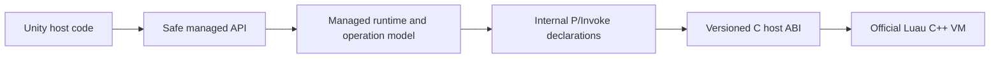

# Maintainer's guide to Luau for Unity

This guide describes the completed Unity-first architecture. Historical stage
plans explain how the repository reached it; they are not current build or
product instructions.

The design goal is the smallest useful set of boundaries: Unity-facing policy,
one managed lifetime and operation model, one internal managed/native contract,
one protected C host ABI, and the official Luau VM.

## 1. Architecture in one picture



There are no alternative product paths hidden behind this flow. Unity hosts do
not call native declarations. The managed runtime does not call upstream headers
directly. The host ABI does not own script-facing policy.

### Change the right layer

| Change | Authority |
| --- | --- |
| Script-facing policy/API | Safe managed API/runtime |
| Lifetime, callbacks, scheduling | Managed operation model |
| Managed/native contract | `luau_host.h` plus package interop |
| Long-jump/error containment | `luau_host.cpp` |
| Language behavior | Official pinned Luau submodule |
| Platform build | `native/luau-host` CMake/toolchains |
| Fast validation | .NET harness over product sources |

## 2. Repository map

| Path | Responsibility | Authority rule |
| --- | --- | --- |
| `Luau.Unity/` | Standalone UPM package | Product and package authority |
| `native/luau/` | Pinned official compiler and VM source | Do not patch language behavior in the host layer |
| `native/luau-host/` | Native build, protected ABI, export audit | Sole native build entry point |
| `native/luau-host/include/luau_host.h` | Complete C contract visible to managed code | Versioned compatibility authority |
| `Luau.Unity/Runtime/Interop/` | `Luau.Interop` and direct `luau_host_*` declarations | Sole C# interop source |
| `Luau.Unity/Runtime/Plugins/` | Maintained native plugins and importer metadata | Package-owned platform artifacts |
| `Luau.Unity/Runtime/` | Unity facade, `Luau.dll`, analyzer | Shipped managed product |
| `src/Luau/` | Canonical source for prebuilt `Luau.dll` | Managed runtime authority |
| `src/Luau.SourceGenerator/` | `[LuauLibrary]` / `[LuauMember]` generator | Sole host API generator |
| `tools/harness/` | Linked interop project and harness-only native artifact behavior | Never linked into Unity runtime source |
| `tests/Luau.Tests/` | Fast behavior, lifetime, failure, generator integration | Tests the shipped netstandard implementation from net9 |
| `Luau.Unity/Tests/` | Package-owned Unity tests | EditMode-specific coverage |
| `tests/Luau.Unity.Integration/` | Development and player-smoke Unity project | Consumes the standalone package; owns project-only assets and settings |
| `tests/Luau.Unity.PackageConsumerProbe/` | Minimal consumer source fixture | Copied into a generated disposable Unity project; not a maintained project |

The removed compatibility facade, duplicate interop tree, filesystem resolver,
call-site generator, and desktop tools are not extension points. If a change
appears to require restoring one, first verify that it belongs in an existing
authority above.

## 3. Native boundary

### 3.1 One build

`native/luau-host/CMakeLists.txt` is the entire native build entry point. It:

- verifies the exact clean Luau submodule revision;
- links only the required upstream static libraries;
- builds the repository-owned `luau_host` dynamic library;
- runs native conformance tests;
- audits the final binary against the [export allowlist](../native/luau-host/exports/luau_host.exports).

Do not add a second build orchestrator or expose upstream `lua_*` functions.
Every managed/native capability must be reviewable in `luau_host.h`.

### 3.2 Contract classes

Each exported function is either:

1. a no-fail observer that cannot allocate, invoke Luau code, or raise; or
2. a protected operation returning `luau_host_status`.

The header documents stack effects and ownership. Native code contains all
long-jump and C++ exception paths before returning through P/Invoke. Error
payloads are inspected without forcing allocation in an exhausted VM.

Luau writes a failed operation's error object without a bounds check, so
`protect()` reserves every slot an operation and its error object need before
it runs. A call that cannot get them, because the frame already holds
`LUAU_HOST_FRAME_SLOT_LIMIT` values or the stack cannot grow, returns
`STACK_LIMIT` and leaves the stack untouched. Operations that only shrink or
rearrange the stack, and reference release, need no slot and cannot fail. Give
each new protected operation its consumed-input and reserved-slot counts.

Luau can run code only on a thread whose status is OK. Every operation that
can reach Luau code, through a call, a metamethod, or an import resolved while
loading, refuses a thread that yielded, is suspended by a break, or ended with
an error with `THREAD_NOT_RUNNABLE`, after argument validation and before the
slot reservation, and runs and consumes nothing (section 6.7). A new
operation that can run Luau code must make the same check.

### 3.3 ABI handshake

The first standalone compile or state creation verifies the native
self-description before crossing any other entry point. Managed validation
covers:

- ABI major/minor and record size;
- pointer width, packing, endianness, and fixed record sizes;
- required feature flags and value tags;
- pinned upstream revision and approved host build fingerprint.

An incompatible plugin fails before VM use. Keep the `artifact-manifest`
command in `tools/Luau.Tooling` pointed at the canonical package interop types
and the managed ABI verifier whenever those files move.

### 3.4 Maintained artifacts

| Target | Package artifact | Runtime |
| --- | --- | --- |
| Windows x64 | `Luau.Unity/Runtime/Plugins/win-x64/luau_host.dll` | Windows Editor and Win64 player |
| Android ARM64 | `Luau.Unity/Runtime/Plugins/android-arm64/libluau_host.so` | Android ARM64 player |
| Android x64 | `Luau.Unity/Runtime/Plugins/android-x64/libluau_host.so` | Android x64 emulator |
| Linux x64 | `Luau.Unity/Runtime/Plugins/linux-x64/libluau_host.so` | Linux Editor and Linux64 players, including servers |

These are the only maintained targets. Preserve each binary's `.meta` file and
review CPU/platform importer settings when installing a rebuilt artifact.

The Windows plugin comes from the `windows-x64` preset, built in CI with the
pinned MSVC toolset. It links the Microsoft C and C++ runtimes statically
(`CMAKE_MSVC_RUNTIME_LIBRARY=MultiThreaded$<$<CONFIG:Debug>:Debug>`, that is
`/MT`, set by the preset and enforced at configure time for every target,
including the upstream archives, the conformance executable, and the ABI
fixtures), so its only import is `KERNEL32.dll`. A Unity Windows player does
not ship `MSVCP140.dll`, `VCRUNTIME140.dll`, or `VCRUNTIME140_1.dll`; a plugin
that imported them, as the plugin did through 0.3.1, fails with
`DllNotFoundException` on a machine without the Visual C++ redistributable.
Development machines and CI runners usually have it, so only a clean player
machine shows the failure; the import audit below is what catches a
regression. The static runtime is safe for the same reason as on Android
(below): no C runtime object crosses the C ABI. The one allocation a caller
receives, a `luau_host_compile` output buffer, is released by
`luau_host_buffer_free` in the runtime that allocated it, and no export takes
or returns a `FILE*`, locale, C++ object, or exception.

The Linux plugin comes from the `linux-x64-shipping` preset, which CI builds in a
digest-pinned Ubuntu 22.04 container with clang 15.0.7. It links the C++
runtime statically, so its only dynamic dependencies are `libc`, `libm`, and the
dynamic loader, and `native-artifacts` rejects any requirement newer than glibc
2.35. The local `linux-x64` preset remains a development host: it is used for
local tests and copied only into disposable Unity projects, never into the
package.

The Android plugins come from the `android-arm64` and `android-x64` presets,
built with the approved NDK r27c (27.2.12479018) for API level 26. They also
link the C++ runtime statically (`ANDROID_STL=c++_static`, enforced at
configure time), so their only dynamic dependencies are `libc.so`, `libm.so`,
and `libdl.so`. A Unity Android player contains `libc++_shared.so` only when
something else ships it, in practice the GameActivity entry point's
`libgame.so`; a plugin that needed it would fail with `DllNotFoundException`
in a player that uses the classic Activity entry point. The static runtime is
safe because the host exports only its C ABI (see 3.2): no C++ object,
allocation, or exception crosses it, every C++ exception and VM long jump is
caught inside the host, and `--exclude-libs` keeps the runtime's symbols out of
the dynamic table. The integration project uses GameActivity, so its player
smoke cannot catch a regression here; the dependency audit does.

Each plugin's allowed dynamic dependencies are listed once, in
`tools/Luau.Tooling/NativeDependencyPolicy.cs`. For the ELF plugins,
`native-artifacts` checks every shipping build against that list with the
pinned `readelf` and confirms the tooling's own ELF reader agrees. For the
Windows plugin it lists the imports with the pinned toolset's
`dumpbin /dependents`, confirms the tooling's own PE reader finds the same
import and delay-load lists, and applies the Windows policy: every imported or
delay-loaded DLL must be `KERNEL32.dll` (compared without regard to case, as
the loader does), and no export may forward to another DLL. It records each
allowlist in the shipping manifest (`linux_allowed_needed`,
`android_allowed_needed`, `windows_allowed_imports`), and the Windows audit
manifest records the MSVC runtime the build was configured with.
`package-static` uses the same readers to check the committed plugins directly,
without native tools, so every managed validation and release run rejects a
plugin that needs anything else.

Both readers treat the file as untrusted and read what the loader reads. The
ELF reader follows `PT_DYNAMIC` through its `PT_LOAD` mapping. The PE reader
locates the import, delay-load import, and export directories through the
optional header's data directories, maps each address through the one section
that contains it, and reads only bytes the loader would load from the file. It
bounds the number of DLLs (64 per table), forwarders (64), exported functions
(65536), and sections (96), and the length of each name (255 bytes), and fails
on anything malformed, truncated, or ambiguous: overlapping or misaligned
sections, a directory or name outside the file data of its section, a
descriptor table without its terminator or whose declared size does not end
there, a descriptor with no name, the obsolete address-based delay-load
format, a bound import directory, or a name that is not printable ASCII.
Adding a dependency is a compatibility decision, not a build detail.

To refresh plugins after a native source change, dispatch the **Build Luau
Host** workflow with `refresh-artifacts=true` on the branch. It rebuilds every
platform and skips the "committed plugin is current" checks. Download each
`luau-host-<platform>-release` artifact and copy its
`out/shipping/<platform>/` binary over the package plugin, then commit them
with the matching managed DLL. Ordinary pull-request and main-branch runs fail
if any committed plugin differs from a fresh build.

In a refresh run, `native-artifacts` audits each fresh build, but the
committed plugins are still the old ones. After a change that the old plugins
do not satisfy, such as a stricter dependency policy, `package-static` (run by
`package-release` in the release-package job, and by `validate-linux`) fails
on the stale plugin until the refresh is committed; that failure is expected.
The Windows job runs the whole .NET solution, tooling tests included, before it
uploads its artifact, so a test asserting a property of the committed plugin
that only the refresh makes true would fail that job and withhold the
replacement. Add such a test after the refresh commit. Do not relax the audit
to get a refresh through.

## 4. Package interop

The package owns the only interop source. `Luau.Interop` uses the internal
namespace `Luau.Internal.Interop` and contains direct declarations corresponding
to `luau_host.h`:

```text
Luau.Unity/Runtime/
    Interop/
        Luau.Interop.asmdef
        AssemblyInfo.cs
        NativeTypes.cs
        NativeMethods.cs
    Plugins/
        win-x64/
        android-arm64/
        android-x64/
        linux-x64/
```

Interop types and methods are internal. The prebuilt `Luau.dll` receives the one
friend relationship needed to call them. Consumer assemblies and generated game
assemblies do not.

`tools/harness/Luau.Interop.csproj` links the exact files under
`Luau.Unity/Runtime/Interop`. It may select and copy a test native artifact, but
it does not own declarations. Prefer normal platform probing; add harness-only
resolver code only when a validated harness case requires it. Unity always
resolves plugins through importer metadata.

The interop layer contains no upstream-shaped compatibility facade, conversion
policy, exception translation, stack abstraction, or consumer API. Those are
managed runtime responsibilities.

## 5. Managed lifetime model

One `LuauVmContext` owns a native root and all managed objects attached to it:

- child threads;
- registry-backed tables, functions, buffers, and userdata;
- callback registrations and native callback references;
- module cache;
- native allocator telemetry;
- sandbox bookkeeping;
- disposal cancellation;
- at most one active operation, plus one finished synchronous operation
  instance kept for the next one (section 6.5).

Disposing a root invalidates every descendant and closes native state exactly
once. Disposal of reference-backed wrappers during an active operation is
deferred until the operation reaches a safe point. Finalizers are fallback
cleanup, never the primary lifetime protocol.

VM access is serialized per root. Independent roots may execute concurrently.
When a continuation scheduler is configured, entry and continuation access must
occur through that scheduler.

## 6. One operation engine

`ScriptOperation` owns root-level execution state; `ScriptRunner` performs entry,
resume, callback injection, result transfer, and cleanup. The engine has three
entry modes:

| Mode | Use |
| --- | --- |
| `TopLevelResume` | Source/bytecode execution, function calls, coroutine resume |
| `NestedProtectedCall` | Managed module execution inside `require()` |
| `DirectHostOperation` | Global/table/metatable/display operations that may invoke Luau behavior |

The modes choose entry mechanics, not separate failure systems. All share:

- root active-operation ownership;
- scheduler enforcement and cancellation;
- interrupt and execution-budget observation;
- allocator and managed callback failure ownership;
- one explicit stack boundary;
- result-count validation;
- reset or terminal-root behavior;
- deferred reference release.

### 6.1 Stack boundary

Each entry captures its base top and explicitly tracks values it produces or
consumes. Success hands validated results to the caller. A void call
(`InvokeVoid`, `InvokeVoidAsync`) wants none: `ScriptRunner` trims the stack to
the base where it takes the result count, so `MaxResultCount` does not apply,
nothing is decoded, and the free frame slot that reading a result needs is not
required: a return that fills or overfills the frame is trimmed like any other.
Managed failure restores the owned base. If native
reset fails, the boundary performs no further stack action: the entire root
becomes terminal and deferred close is the only remaining native operation.

Review stack effects at each call site. The boundary is an ownership tool, not a
reason to hide pushes, consumes, or result counts.

### 6.2 Failure precedence

When multiple observations compete, the engine uses one deliberate order:

1. hard stop (disposal, caller cancellation, wall clock, interrupt budget);
2. managed callback failure;
3. allocator or native operation failure.

The same order applies to top-level, nested require, and direct host modes.
Structured tests assert exception type, chunk/callback identity, allocator
diagnostics, original/final stack top, and whether the root remains reusable.

### 6.3 Interrupt throttle

Every call, return, and loop back-edge is a Luau interrupt safepoint, so a
reverse call into managed code at each one would cost far more than the Luau
instructions in between. `BeginOperation` hands the
operation's count limit and remaining wall-clock time to
`luau_host_interrupt_configure`; the native trampoline then counts safepoints,
reads its clock every few safepoints, and calls the managed poll only when the
count passes the limit, the deadline passes, or attention was requested. The
managed poll stays the authority for what happens: it applies the failure
precedence below and reads the native count for the budget exception.

The throttle is correct only if everything that can make the poll act
requests attention when it happens:

- pending callback work (`RecordCallbackFailure`, `QueueAsyncCallback`)
  requests from the operation's own thread, which keeps the root open;
- caller cancellation, the deadline watchdog, and state or root disposal
  request from other threads under the lifecycle gate, and only while their
  operation's life is active (section 6.5), so the request can never race
  native close or reach a later operation.

A new hard-stop source or kind of pending work must do the same, or it will be
observed only at the next count or clock event. `InterruptThrottleTests` run
without any budget that would stop the script in time, so a missing request
shows up as a script that keeps running until the test's safety net.

### 6.4 Direct operations cannot suspend

A table/global/metamethod operation may run Luau code, so it joins the operation
engine even when called directly by a host. It may not suspend asynchronously.
If it yields, the engine aborts/resets it and reports a deliberate managed
failure. Do not reintroduce per-call `originalTop`/`restoreStack`/`resetAttempted`
blocks; extend the shared boundary instead.

### 6.5 Operation lives and lazy machinery

Per-frame hooks make many small calls into the same root, so entering and
leaving the VM must not allocate. A root therefore reuses one `ScriptOperation`
for consecutive synchronous operations. Each `BeginOperation` starts a new
*life* of an instance, with a new `Generation`; `EndOperation` ends it.

Reuse is safe only under these rules:

- `EndOperation` keeps the instance for the next operation, under both gates,
  only when nothing can still name the finished life: the operation was
  synchronous, had no caller cancellation registration, published no
  asynchronous ambient marker, restored its thread-ambient slot, and its root
  stays open. Asynchronous operations are always new instances, because an
  execution context captured during one can reference it indefinitely.
- Anything that can outlive a life compares the generation, not only the
  reference: `RequestInterruptAttention(operation, generation)`,
  `EndOperation`, the ambient check, the watchdog (which reads the active
  life under the lifecycle gate), and a callback's
  `LuauOperationCancellation`. `ReferenceEquals` alone does not identify a
  life.
- `Activate` publishes the new generation before resetting the per-life
  fields, and `ClearForReuse` drops every reference the life held, so a kept
  instance holds no state, string, exception, or token.

Nothing an operation might use is created up front:

- **Options.** An operation without options uses the state defaults as they
  are. The context caches merged per-operation options by instance, so the
  Unity scheduler, which passes the same options object on every call, does
  not rebuild a record per call.
- **Callback token.** The callback-visible `CancellationToken` is created the
  first time a callback reads it (`LuauCallContext.CancellationToken`, or a
  generated member's `CancellationToken` parameter). It links the state's
  lifetime token and the root's disposal token, which their owners cancel
  only after requesting the poll; caller cancellation and the deadline cancel
  it explicitly, also after requesting the poll. A token created after one of
  those stops already happened is returned canceled, and its source is
  disposed when the life ends, so a token a callback captured is never
  canceled by a later life.
- **Deadline.** There is no timer per operation. Each root publishes its
  active operation's deadline timestamp, and one process-wide
  `LuauDeadlineWatchdog` timer is armed for the earliest published deadline.
  Starting an operation costs a fenced store and a read; the timer is
  re-armed only when an operation starts with an earlier deadline, or when it
  fires and a later one is still running, and stays idle while no operation
  with a wall-clock limit runs. When it finds a passed deadline it requests
  the poll first, then cancels that life's callback token if one exists, each
  root's on its own work item. It fires at the deadline plus the timer
  resolution (about 1 ms on Linux and Android, up to about 16 ms with
  Windows' default resolution), the bound the per-operation timer gave.
- **Ambient operation.** A synchronous operation begins and ends on one
  thread, so it records itself in a thread-static slot rather than writing
  the execution context. An asynchronous operation can continue on any
  thread, so it publishes an `AsyncLocal` marker carrying its generation, and
  so does a synchronous operation that begins inside a flow that already has
  one. `ThrowIfNativeAccessDenied` uses the flow's marker when there is one
  and the thread's slot otherwise. A flow forked from inside a synchronous
  callback (for example by `Task.Run`) is therefore rejected while that
  operation runs; it used to pass the check and then wait for the VM.

`OperationReuseTests` pins the steady-state allocation of each entry point
and each of these hazards; `entry-*` cases in `benchmarks/Luau.Benchmarks`
measure the per-call cost.

### 6.6 A new call needs a thread with nothing pending

Native resume continues whatever a thread has pending. On a thread that
yielded or was interrupted, `luau_host_resume` continues that continuation and
drops a callee pushed above it, so the host's new chunk never runs and the
call returns what the script's old code returns. On a script-created coroutine
whose function has not started, a new callee runs above that function, and the
reset after a failed call discards it. Every top-level entry other than
`Resume*` (source, compiler output, verified bytecode, function invocation)
therefore starts only on a thread with nothing pending; only an entry that
passes `resumesThread: true` may continue a suspended one.

`LuauVmContext.BeginOperation` makes the check, after the active-operation
check and under both gates, before the entry pushes anything. No other
operation can resume or reset the thread before this one enters it, and a
rejection (`InvalidOperationException`) leaves the thread exactly as it was.
The order a caller observes is: disposed, scheduler, another flow ("executing
on another operation"), an active operation ("already executing"), then
suspended. A thread waiting on an asynchronous callback is inside an active
operation, so it reports that the VM is executing.

The root skips the native read: `RejectRootYield` resets a root that an
operation left suspended, so the check could never fire there, and function
invocation and script entrypoints, which run on the root, pay nothing for it.
Nested module execution and `SandboxThread` run a protected call, which is
valid on a running thread or an unstarted coroutine but not on a suspended
one; they make the same check before they load a chunk or change the
thread's globals, and `SandboxThread` also rejects a thread that ended with an
error. Direct host operations do not start a call and are not checked; they
work on a suspended thread (section 6.7).

A thread that a failed call reset accepts a new call. A script-created
coroutine that died with an error is not suspended: the call reaches the VM,
which refuses to resume it with `LuauException`, and that failure resets the
thread for the next call.

A new entry point must begin its operation through `BeginOperation` and set
`resumesThread` only when it continues a pending call, or make the same check
under the native gate before it pushes. `SuspendedThreadEntryTests` covers
every entry point against each kind of suspended thread.

### 6.7 Direct operations on a thread that cannot run code

Luau runs code only on a thread whose native status is OK: running, finished,
or holding a coroutine function that has not started. On a thread that
yielded, is suspended by a break (an async callback waiting, or a coroutine
waiting in `coroutine.resume` on a broken child), or ended with an error, the
interpreter, which checks the thread status at each interrupt safepoint and
after each call, leaves any function started there as if it had just
suspended, so `luaD_call` returns with that function's frame still in place.
`protect()` contains errors, not this; the next resume continues from the
corrupted frame and crashes. Direct host operations reach such threads in
ordinary use: a host writes a script thread's globals every frame whatever the
script is doing, an async callback runs while its thread (and, for a root call,
the root, where every `LuauTable` operation runs) is suspended, and the
sandbox's write guard, a `__index` or `__tostring`, and an import resolved
while loading are all Luau code.

The native host is the backstop. `table_get`, `table_set`, `global_get`,
`global_set`, `to_display_string`, `load`, `open_library`, and `pcall` refuse
such a thread with `THREAD_NOT_RUNNABLE`. The refusal is stack-neutral, so a
managed bug cannot reach the crash: `ThrowIfFailed` turns an unhandled refusal
into `InvalidOperationException`.

The managed runtime treats the refusal as the signal to do the work elsewhere,
in `LuauState.RunnableThread.cs`, so the common paths pay nothing for the
check:

- Global reads and writes, metamethod-aware `LuauTable` reads and writes, and
  display conversion move their inputs with `stack_move` to the root's *host
  operation thread*, run the operation there, and move the results back, so
  the target thread's stack ends exactly as the refused operation would have
  left it. Global access pushes the target's own globals with `global_push`
  and indexes that table, which is what `lua_getfield(LUA_GLOBALSINDEX)` does.
  Each needs no more slots on the target than the operation itself, and the
  frame-slot limit applies to every push. The moves cost about 300 ns per
  access (`entry-yielded-thread-global-*` benchmarks) and allocate nothing.
- `load` and `open_library` depend on the thread's globals: imports resolve
  against them, and libraries register into them. They run on a new thread
  created from the target, which inherits its globals, parked on the host
  operation thread while in use. These are rare, so the allocation is
  acceptable.
- The host operation thread is created from the root on first use and kept
  by a registry reference in `LuauVmContext`. Code running there is inside a
  protected call, so it can neither yield nor break; a hard stop is raised as
  `CANCELED`, and a callback failure is raised and reported as on the root.
  Because a metamethod can return `coroutine.running()`, the host can obtain
  the thread and leave it suspended, so `AcquireHostOperationThread` checks
  its status and replaces it when it is not runnable. Nested use (a metamethod
  that calls back into a direct operation on another suspended thread) finds
  it running, which is valid.
- A metamethod run this way observes the host thread in `coroutine.running()`,
  and it can resume the target if the target yielded: that is ordinary Luau
  behavior, and the operation stays sound because nothing on the target's
  stack is used after the code runs except to receive the results.
- Nesting is bounded by `MaximumHostOperationThreadDepth` (16). Luau counts
  recursion per thread, and `load` and `open_library` run on a thread made for
  that one use, so Luau code they reach that calls back into a host function
  which starts another would recurse without any count until the process stack
  overflowed. `AcquireHostOperationThread` counts every redirected operation
  in progress and refuses the one past the limit with
  `InvalidOperationException`; each caller releases the count in a `finally`.

An async callback's suspension used to leave `YieldReason.AsyncCallback` set
while the callback ran, so the first interrupt poll in any Luau code the
callback's direct operations ran stopped it as a hard stop.
`MarkAsyncCallbackSuspended` clears the reason once the runner has acted on
it.

`SandboxThread` is the one direct operation that refuses instead: it
replaces the thread's globals and then runs the guard chunk there, which is
not valid on a thread with a pending continuation or a failed call, so it
rejects either before changing anything.

`SuspendedThreadHostOperationTests` checks the target's status and stack before
it resumes, so a regression fails there rather than crashing the test host;
the native conformance suite drives every refusing operation on a yielded,
broken, waiting, and errored thread in its own process and under the
sanitizer build. Allocation of the per-frame global paths on a yielded thread
is pinned in `SuspendedThreadHostOperationAllocationTests`.

## 7. Managed callbacks

### 7.1 Safe context

All public manual and generated callbacks use `LuauCallContext`. It is a small,
generation-checked callback value with:

- zero-based `ArgumentCount` and `Read<T>(index)`;
- typed `Return<T>` helpers;
- operation cancellation, created on first read (section 6.5);
- an optional callback name for diagnostics.

It exposes no native handle, raw stack top, registry index, native callback
delegate, or arbitrary C-function push. Every operation validates the invocation
generation. Copies retained after completion fail deterministically.

A ref-like context is intentionally not used: it cannot represent the async
callback protocol supported by Unity. For async callbacks, the VM first yields
and unwinds from native resume; managed code then runs under the configured
scheduler. Typed arguments/results may be accessed only while that callback
generation is valid.

### 7.2 Callback failure protocol

Managed exceptions never cross reverse P/Invoke. A callback failure is recorded
against the active operation. The VM yields when possible, the managed runner
observes the failure after native control returns, and an opaque failure token is
injected only when Luau must observe the error through `pcall`.

An internal raw callback form exists only for runtime plumbing and focused tests.
It is not visible to package consumers or generated host libraries.

## 8. Host API generation

`[LuauLibrary]` on a top-level partial class plus `[LuauMember]` on explicit
members is the only source-generated API model:

```csharp
[LuauLibrary("ship")]
public partial class ShipApi
{
    [LuauMember("fuel")]
    public int Fuel { get; private set; }

    [LuauMember("consume")]
    public bool Consume(int amount) => amount <= Fuel;
}
```

Generated code is readable and AOT-safe. It performs:

- library instance registration;
- typed context reads and returns;
- context/cancellation injection;
- sync or awaited invocation;
- property/field get and set dispatch;
- readonly enforcement;
- root-table registration before sandboxing.

It performs no reflection, location-based call-site dispatch, native access, or direct
P/Invoke. Generator diagnostics reject unsupported declarations, duplicate or
invalid exported names, ambiguous overloads, init-only writes, and unsupported
generic/nested forms.

Generator tests cover sync/async and supported conversions, instance/static
members, fields/properties, readonly behavior, diagnostics, stable output, .NET
Roslyn compilation, Unity compilation, and IL2CPP execution.

The analyzer is a precompiled `Luau.SourceGenerator.dll` labeled
`RoslynAnalyzer` in Unity. Its `.meta` file remains part of the artifact identity.

## 9. Managed `require()`

`require()` remains an opt-in managed capability. Resolver implementations own
path/alias policy, I/O, byte limits, and source-versus-bytecode trust. The Unity
package supplies Resources and optional Addressables resolvers; it does not ship
a filesystem resolver.

Module execution:

1. resolves a VM-wide cache key;
2. creates a fresh child of the root, sandboxed when the root is sandboxed;
3. compiles/loads according to source or bytecode trust policy;
4. runs through `NestedProtectedCall` under the already-active root operation;
5. requires exactly one result;
6. caches that result at VM scope without retaining a caller's private global
   proxy.

Nested execution shares cancellation, budgets, callback ownership, allocator
translation, stack restoration, and terminal behavior with its parent. It does
not acquire a second root operation and does not use a private error translator.

## 10. Sandboxing and trust

Normal state factories default to:

- rejecting ordinary host-supplied bytecode;
- no OS or debug library;
- no `require()` until a resolver is explicitly installed;
- host API registration before root sandboxing;
- root sandboxing before untrusted children are returned;
- Unity continuation scheduling when created through `LuauUnity`;
- bounded Unity `print` formatting.

Sandboxing does not replace host policy. Untrusted workloads still require finite
input, memory, execution, and result limits; reviewed callbacks; logging policy;
and a cancellation path. Trusted bytecode and privileged libraries remain
explicitly named capabilities.

### 10.1 Background compilation

`ILuauCompilationService` is the backend-neutral boundary used by streamed-mod
and SDK/editor-preview code. `LuauThreadedCompilationService` is the first
backend. It owns a lock-protected queue and one or two long-lived background
threads; it never uses unrestricted `Task.Run` calls and never touches a
`LuauState`, Unity API, imported asset, caller buffer, or synchronization
context from a worker.

Admission copies UTF-8 source, snapshots compile options, then atomically
reserves both an incomplete-request slot and its source bytes. The immutable
service policy bounds:

- worker count (one by default, at most two);
- incomplete request count;
- aggregate source bytes held by incomplete requests;
- source bytes per request;
- bytecode bytes per result; and
- the finite shutdown drain period.

The Unity recommendation is one worker/32 slots for Windows Editor and Player,
or one worker/16 slots for Android ARM64/x64. The second Windows worker remains
an explicit host opt-in. Each host owns a service instance; there is no global
compiler service. The Unity factory weakly tracks only the instances it creates
so player exit and Editor assembly reload can request concurrent disposal and
report a finite aggregate drain timeout.

Cancellation is linearized with worker ownership. Pre-admission cancellation
creates no work. Queued cancellation physically removes the request and releases
its reservations. Running cancellation marks its native output for discard; it
does not abort the thread or interrupt `luau_host_compile`. The outcome commits
before publication; cancellation registration cleanup and result publication
then finish while the request remains inside the configured incomplete-request
and source-byte bounds. Later cancellation has no effect.
Shutdown rejects admission, cancels queued requests, and lets active native
calls finish. Every native output buffer is freed by `LuauCompiler`'s existing
`finally` path, including diagnostic, over-limit, and canceled/discarded output.

A successful `LuauCompileResult` contains the original compiler-issued
`LuauCompilerOutput`; copied bytes cannot reconstruct that same-process loading
capability. Diagnostics, cancellation, and infrastructure failure are separate
result kinds. Persistent caches still require `LuauBytecodeArtifact` plus host
provenance validation.

Compilation completion is not permission to enter a VM. Ordinary
`state.ExecuteAsync(asset)` calls compile through the package-owned lane, then
post installation to the state's configured continuation scheduler. Advanced
callers can provide an isolated service through
`ExecuteWithCompilationServiceAsync`. The services themselves remain VM-free,
so a later process-isolated backend does not change mod-streaming or cache code.

Threads solve owner-thread responsiveness and bounded admission. They do not
isolate native crashes, compiler hangs, or compiler intermediate memory, and
cannot enforce a hard timeout after native compilation starts. The native
conformance gate therefore proves concurrent independent-buffer ownership,
mixed valid/invalid stress, and serial/parallel deterministic output. Managed
tests cover admission, cancellation, disposal, and result-publication races.

Unity's `ScriptedImporter.OnImportAsset` contract remains synchronous. It still
compiles transiently for deterministic authoring diagnostics. Legacy
`DoStringAsync` compiles before its first await, while ordinary source-asset
`ExecuteAsync` uses the package-owned bounded background lane. Streaming code
that needs an independent queue or lifetime can construct a service and use the
explicit service-accepting asset overload.

## 11. Managed artifact decision

The package ships prebuilt Release `Luau.dll`. Direct source shipping was rejected
without a branch experiment because the authoritative source uses compiler and
framework features that would require broad syntax changes, extra package
dependencies, or a fragile custom compiler arrangement in Unity. That would
replace one explicit copy with a larger maintenance surface.

The final build relationship is:

- `src/Luau` builds one `netstandard2.1` artifact for Unity;
- net9 tests consume that exact target rather than a separate net9 library build;
- `Luau.SourceGenerator` remains a Unity-compatible analyzer assembly;
- the explicit .NET tooling command checks/copies only `Luau.dll`, `Luau.xml`,
  and `Luau.SourceGenerator.dll`;
- package interop source is never copied because the package owns it;
- ordinary build/test commands never mutate package artifacts.

The stale-artifact check compares deterministic Release outputs with the
checked-in package DLLs. Do not hide refresh behavior in an MSBuild target.

## 12. Build and validation

### 12.1 Fast managed validation

```bash
dotnet restore Luau.slnx
dotnet test Luau.slnx --no-restore
```

This covers managed values, lifecycle, hardening, operation modes, require,
callbacks, ABI rejection, background-compilation admission/cancellation races,
parallel determinism, and generator behavior without launching Unity.
On Linux, install the `linux-x64` preset first so the harness has its local
development host; `validate-linux` performs that ordering automatically.

### 12.2 Explicit managed refresh

```bash
dotnet run --project tools/Luau.Tooling -- managed-artifacts --configuration Release
dotnet run --project tools/Luau.Tooling -- managed-artifacts --configuration Release --check
```

The command is the only normal path that may update the checked-in managed
artifacts and XML documentation. Its check mode must fail when source and
package outputs differ.

### 12.3 Native validation

Run from `native/luau-host`:

```bash
cmake --preset windows-x64
cmake --build --preset windows-x64 --parallel
ctest --preset windows-x64

cmake --preset android-arm64
cmake --build --preset android-arm64 --parallel

cmake --preset android-x64
cmake --build --preset android-x64 --parallel

# Local Linux development host; never copied into the package. The shipping
# plugin uses the linux-x64-shipping preset inside the CI container.
cmake --preset linux-x64
cmake --build --preset linux-x64 --parallel
ctest --preset linux-x64
cmake --install out/build/linux-x64
```

Installing a rebuilt plugin is a deliberate action separate from managed
refresh. Recheck exports, manifest identity, ABI handshake, and `.meta` importer
settings. Native conformance includes thousands of mixed concurrent compiler
calls and exact serial/parallel output comparison.

### 12.4 Package validation

```bash
dotnet run --project tools/Luau.Tooling -- package-static
dotnet run --project tools/Luau.Tooling -- package-release
dotnet run --project tools/Luau.Tooling -- package-consumer \
  --unity /path/to/6000.3.xf1/Editor/Unity \
  --unity-version 6000.3.xf1
```

The static check validates package boundaries, importer metadata, and the
dynamic dependencies of every committed plugin (ELF dependencies, and the
Windows plugin's imports, delay-load imports, and forwarded exports) without
launching Unity. The consumer check copies only
`tests/Luau.Unity.PackageConsumerProbe` into a generated disposable Unity
project, resolves the standalone package, compiles generated host bindings,
loads the native plugin, and executes a representative script. It is not a
second maintained Unity project.

### 12.5 Unity validation

On Linux, run the integration tests through a disposable staged project:

```bash
dotnet run --project tools/Luau.Tooling -- unity-test \
  --compile --editmode --linux-smoke \
  --unity /path/to/6000.3.xf1/Editor/Unity \
  --unity-version 6000.3.xf1
```

`validate-linux` combines the native build/install, complete .NET suite, host
soak, package gates, generated consumer, Unity compile/EditMode suite, and Linux
x64 IL2CPP smoke. See [Linux development](linux-development.md).

The same `unity-test` command preserves the maintained player-smoke entry
points: use `--windows-smoke`, `--android-arm64-smoke`, or
`--android-x64-smoke`. Android gates accept `--adb` plus the corresponding
`--android-arm64-serial` or `--android-x64-serial`; target selection still
requires a uniquely eligible online Quest or x64 emulator.

The required player gates are Windows x64 IL2CPP, Android ARM64 IL2CPP on a
device, and Android x64 on an emulator. The disposable smoke temporarily enables
first-party precompile, imports one opted-in Resources asset, regenerates the
manifest during the build, and executes that asset through
`UseFirstPartyBytecode`. It also covers background source compilation, explicit
Unity-owner scheduler handoff, and same-process output execution. The build
helper must restore project settings and package-owned generated assets in its
`finally` path. A successful build without the stable runtime pass marker is not
a smoke pass.

## 13. Common changes

### Change a public managed API

1. Update `src/Luau` or the Unity facade.
2. Update the public API baseline deliberately.
3. Add fast managed coverage and Unity coverage when package behavior changes.
4. Rebuild and check the two managed artifacts explicitly.

No public signature may expose interop types, pointers, native delegates, or raw
stack ownership.

### Change the native contract

1. Update `luau_host.h` with documented ownership and stack effects.
2. Update `luau_host.cpp` containment.
3. Update package interop directly.
4. Update ABI/layout/conformance/export tests and the manifest audit.
5. Rebuild each maintained plugin and review its `.meta` file.
6. Run all managed, Unity, and player gates.

Treat ABI version, host fingerprints, native binaries, and managed verifier as
one compatibility unit.

### Change generator behavior

1. Keep the attributed library model; do not add a second registration model.
2. Update semantic diagnostics and stable generated snapshots.
3. Compile representative output under .NET and Unity.
4. Exercise the result in the IL2CPP player smoke.

### Update upstream Luau

1. Update the `native/luau` submodule deliberately.
2. Review upstream behavior and ABI assumptions.
3. Rebuild all maintained native targets.
4. Update fingerprints/manifests as one compatibility unit.
5. Run native conformance, managed parity, Unity, and all player gates.

## 14. Invariants to defend

- Unity package code is the product authority.
- Package interop is the only C# declaration source.
- Only direct `luau_host_*` declarations cross managed/native.
- No public API exposes a native handle, pointer, delegate, or stack contract.
- One root owns every child, reference, callback, module, and operation.
- One operation engine owns every failure and stack boundary.
- Hard stops outrank callback failures; callback failures outrank
  allocator/native failures.
- Async managed work begins only after native resume has unwound.
- Anything that can make the interrupt poll act requests native attention
  when it happens.
- Anything that can outlive an operation life checks its generation, not
  only its reference; an instance is reused only when nothing can name it.
- The steady-state synchronous call allocates nothing: no per-operation
  timer, token source, options record, or execution-context write.
- Only `Resume` continues a suspended thread; every other entry rejects a
  thread with a pending continuation before it pushes anything.
- No host operation runs Luau code on a thread whose status is not OK; the
  native host refuses it, and direct operations run that code on a runnable
  thread of the same root instead.
- Generated host APIs are attributed, reflection-free, and IL2CPP-safe.
- `require()` remains managed, opt-in, sandbox-aware, and on the shared engine.
- Normal builds do not mutate the Unity package.
- Only Windows x64 and Android ARM64/x64 are maintained.

If a proposed convenience weakens one of these invariants, it belongs in a
separate design review rather than an incidental change.

## 15. Debugging by symptom

### Native plugin cannot be loaded

Check the maintained artifact path and its Unity importer metadata. In the .NET
harness, verify which Windows artifact `tools/harness` copied to the application
output. Do not add runtime probing code to the Unity package.

On Android, a `DllNotFoundException` for a plugin that is present in the APK
usually means a dynamic dependency is missing from the player. List them with
`readelf -d` and compare them with the policy in section 3.4; `package-static`
fails on any committed plugin that needs more than the allowed system
libraries.

On Windows, the same exception in a player on a machine without the Visual C++
redistributable means the plugin imports a runtime DLL. List its imports with
`dumpbin /dependents` (or `llvm-readobj --coff-imports`); the shipped plugin
imports only `KERNEL32.dll`, and `package-static` rejects anything else.

### ABI compatibility rejection

Treat this as a compatibility-unit mismatch. Compare the package interop,
managed verifier constants, native manifest, plugin hash, and pinned submodule.
Do not bypass the handshake.

### State reports another active operation

One root permits one active operation. Look for reentrant execution, access from
outside the configured scheduler, or a callback attempting to start top-level
execution on its own root.

### A call reports a suspended thread

The thread yielded, or it is a script-created coroutine whose function has not
started, and a host tried to start a new call on it. Resume it until it
finishes (`GetStatus()` reports `Dead`), or start the call on another thread.
Do not weaken the check: native resume would continue the pending code
instead of the new call (section 6.6).

### Retained call context throws

`LuauCallContext` is callback scoped. Read arguments and return results during
the active generation; copy durable managed values rather than retaining the
context.

### A host operation reports a thread that cannot run Luau code

The native host refused an operation that can run Luau code on a thread that
yielded, is suspended by a pending callback, or ended with an error, and the
managed caller did not move the work to a runnable thread. Do the same as the
direct operations in section 6.7; do not weaken the native check.

### Direct table/global access reports a yield

Direct host operations cannot suspend. Move asynchronous behavior into a normal
Luau execution/callback flow instead of weakening the direct-operation mode.

### Root is disposed after a failure

The native reset failed and the root became terminal. The operation engine must
perform no further native action except deferred close. Preserve the original
typed failure and create a new root.

### Unity compiles but a player fails

Editor compilation does not prove player plugin selection, reverse callback
retention, analyzer output, or IL2CPP behavior. Inspect the target's `.meta`
settings and run the matching player smoke.
